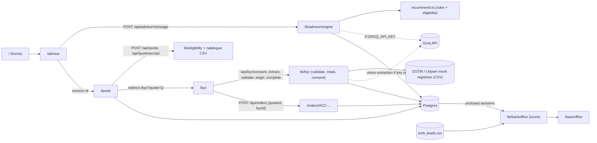

# Udyam Digital: digital-first MSME acquisition prototype (Accel Business)

A phone-first, multi-language (English, Hindi, Tamil, Marathi) prototype of the journey from "I run a small business" to "my installation is booked", with minimal human effort:

**Advisor chat -> transparent quote -> Smart KYC -> e-sign -> order tracker**, plus a **back-office** view that ranks unclosed leads by a transparent propensity score so the field force and channel partners know who to call first.

It is built for the "Build challenge" of the Airtel SYNC case (`../airtel_sync/Airtel_SYNC_Case.pdf`). Everything runs locally on the provided CSVs and specimen KYC documents. There is no real GST, Udyam, DigiLocker or e-sign integration (all simulated).

## Run it

```bash
cd app
npm install
cp .env.example .env.local      # fill DATABASE_URL, session secrets; GROQ_API_KEY is optional
npm run db:migrate              # applies db/migrations against the direct (non-pooled) URL
npm run db:seed-staff           # demo staff accounts
npm run dev                     # http://localhost:3000
```

- `.env.local` must sit in this directory (next to `package.json`), not inside `app/app/`. It is gitignored (`.env*.local`). Names only are listed in `.env.example`. Never commit the connection string or secrets.
- App traffic uses `pg` against the pooled `DATABASE_URL` (Neon host with `-pooler`). Migrations and the staff seed use `DATABASE_URL_UNPOOLED`.
- `GROQ_API_KEY` is optional. Without it the app is fully functional using the rule-based fallback (see "Groq vs fallback").
- Other env vars: `GROQ_CHAT_MODEL`, `GROQ_VISION_MODEL`, `CUSTOMER_SESSION_SECRET`, `STAFF_SESSION_SECRET`, `OTP_PROVIDER` (`mock`), optional `STAFF_SEED_PASSWORD`.
- Checks: `npx tsc --noEmit`, `npm run build`.
- State lives in Postgres: sessions, quotes, masked KYC, orders, users, OTP codes, staff, assignments. CSV leads stay in files.
- Customer login is mobile + OTP at `/login`. With `OTP_PROVIDER=mock` the code is `123456`. Sign-up asks for a name and a business name. Accepting a quote requires login; after the OTP the customer returns to the quote, then continues to Smart KYC.
- Demo staff (password `Demo@12345`, from `scripts/seed-staff.mjs`, override with `STAFF_SEED_PASSWORD`): `admin@accel.example` (admin), `sales@accel.example` (sales), `partner@accel.example` (partner, sees only leads assigned to partner id `P-ACCEL`). Sign in at `/staff/login`. Logged-out visits to `/backoffice` redirect there. There is no public Back office link.
- Order history on `/orders` is only for the logged-in customer. Logged out, that page is only a tracking-ID box. Anyone with an id (`ACC-` plus 10 random base32 characters) can open `/orders/[id]` and sees status, timeline and ETA, with no phone number or other personal identifiers.
- The advisor recommends from the business type (`lib/advisor/profiles.ts`). A salon or parlour gets Fibre 100 or AirFiber, a mobile line and WhatsApp. It does not get Fibre 300 or a managed firewall.
- The landing page (`/`) is the shared phone-first design: "Find my bundle" opens `/advisor`, "Track order" / "Track your order" opens `/orders`. It also shows the four steps, bundles by trade, languages (English, Hindi, Tamil, Marathi) and a short FAQ.
- Demo dates are anchored to the case "today", 2026-07-15 (`lib/eligibility.ts`), so expected install dates are relative to that.

## Journey walkthrough

| Step | Page | What happens |
|---|---|---|
| 1 | `/` | Landing. "Find my bundle" goes to `/advisor`. "Track order" goes to `/orders`. Language picker in the header (persists in `localStorage`). No public Back office link. |
| 2 | `/advisor` | Chat with quick-reply chips: business type, headcount, sites, city (tier 1/2), GSTIN yes/no, current internet, monthly spend. Ends with a recommended bundle, plain-language reasons, optional add-ons and anything left out (e.g. "WhatsApp Business API needs a GST number"). |
| 3 | `/quote?session=S-...` | Editable quote. Add/remove products, change quantities, price updates live. Ineligible products are greyed with the reason. Dependencies are enforced: adding Backup Failover auto-adds a connectivity base; removing the last connectivity product removes its dependants with a notice. Accept -> `/api/quote/accept`. |
| 4 | `/kyc?quote=Q-...` | DPDP consent -> documents (upload, or pick a specimen applicant K01-K12 / simulated DigiLocker) -> confirm extracted fields (masked) -> automated checks -> simulated e-sign (demo OTP `123456`) -> finish. |
| 5 | `/orders/ACC-...` | Tracker: Quote accepted -> KYC complete -> Installation scheduled -> Installing -> Activated, per-product install estimates, "what happens next". A **Demo: advance status** button simulates the real-world steps. The id is unguessable. |
| 6 | `/backoffice` | Staff only (`/staff/login`). Admin and sales see the pipeline; a partner sees only leads assigned to their partner id. KPIs and funnel come from the 5,000-lead CSV, plus abandoned in-app advisor sessions as `In-app advisor` leads, ranked by score with the top factors and a suggested action/owner. |

Specimen outcomes to try on `/kyc`: **K03** Ganesh Woodcraft -> *Verified* (order goes straight to "Installation scheduled"); **K11** Trinity Bake House -> *Needs review* (address proof 257 days old; you can still e-sign, and the order waits at "KYC under review"); **K01** Vindhya Tours -> *Rejected* (cancelled GSTIN, blank Udyam number; e-sign is blocked and no order can be created).

## Architecture and data flow



Session linkage: the advisor creates a `Session` (`unclosed: true`). `/api/quote/accept` stores an accepted `Quote`, links it to the session and sets `unclosed: false`, so accepted customers never appear as abandoned leads. KYC records link to the quote; `/api/orders` links order, quote and KYC.

## Module map

| Path | Role |
|---|---|
| `app/advisor`, `app/api/advisor/message` | Chat UI and API; resumable via session id in `localStorage` |
| `lib/advisor/engine.ts`, `recommend.ts`, `strings.ts` | Slot filling, segment detection, bundle rules, localised strings |
| `app/quote`, `app/api/quote`, `app/api/quote/accept`, `lib/quote-server.ts`, `lib/eligibility.ts` | Quote editor, validation, pricing, dependencies |
| `app/kyc`, `app/api/kyc/*`, `lib/kyc/*` | Consent, extraction, GSTIN/Udyam lookups, validation, masking, specimens, persistence |
| `app/orders`, `app/orders/[id]`, `app/api/orders*`, `lib/orders-server.ts` | Order creation, tracker, demo advance |
| `app/backoffice`, `app/staff/login`, `middleware.ts`, `app/api/backoffice/*`, `lib/backoffice/*` | Staff-only lead table, KPIs, propensity score, assignment. Partners are limited to their partner id. |
| `lib/ai/provider.ts` | Server-only Groq client with deterministic fallback |
| `lib/data/*`, `lib/db.ts`, `db/migrations` | CSV loaders and the Postgres repository |
| `data/` | Provided CSVs: product catalogue, leads, mock GSTIN and Udyam registries |
| `components/`, `lib/i18n*.ts` | Header, language picker/provider, shared strings |
| `scripts/` | Lead analysis and propensity fitting (Python), specimen validation (TS) |

## Segments and bundles

The bundle is chosen from the business type in `lib/advisor/profiles.ts` (salon, kirana, pharmacy, restaurant, clinic, coaching, professional, retail, hotel, manufacturer, logistics, plus size fallbacks). A salon or parlour stays on Fibre 100 or AirFiber, one mobile line and WhatsApp; Fibre 300, a managed firewall, SD-WAN, leased lines and IoT are not in that plan. Eligibility still comes from catalogue columns: city tier, min employees, min sites, GSTIN requirement and `requires_one_of` dependencies. Extra seats, devices and add-ons go to optional lines and can be added on `/quote`. Typical monthly prices (mid-point of the catalogue range):

| Segment | Core bundle | Example monthly |
|---|---|---|
| Micro retail/services | AirFiber or Fibre 100, 1-2 mobile lines, Cloud POS (WhatsApp API, CCTV, Wi-Fi optional; WhatsApp needs GSTIN) | ~2.1-2.5k |
| Professional office | Fibre, 1-3 mobile lines, up to 6 email seats, 1-3 telephony channels, up to 6 endpoint licences (backup, static IP, Wi-Fi optional) | ~4.0-5.5k (12-person CA firm ~4.6k) |
| Multi-site | Fibre 300 + SD-WAN + failover + firewall per site, 2 cameras per site, 1 mobile line per site | ~8.5k per site |
| Small manufacturer | Leased line (Fibre if smaller), IoT monitoring, firewall, mobile lines | ~13.6k (30 staff), ~35k (80 staff, 100 Mbps leased line) |

## Groq vs fallback

All AI calls go through `lib/ai/provider.ts` (server-side only; the key never reaches the browser).

- **Key set and call succeeds:** the advisor uses Groq for flexible free-text understanding (slot extraction, multilingual replies); KYC uses a vision model to read uploaded document images.
- **No key, a timeout, a rate limit or any API error:** the provider never throws; it runs the caller-supplied deterministic `fallback`. The advisor then uses keyword/regex slot extraction and templated localised strings; KYC uses the specimen transcription table (`lib/kyc/specimens.ts`) for files named `K##_<doc>.png`.
- The bundle, the prices and every KYC verdict are computed by deterministic code in both modes. The model never decides pricing or eligibility.
- Responses carry an `ai: "groq" | "fallback"` flag (and a non-secret `fallbackReason`) for debugging.

## KYC validation checks

Run server-side by `lib/kyc/validate.ts`; each check is pass / warn / fail with a plain-language fix. Verdict: any blocking fail -> **rejected**; any other fail or warn -> **needs_attention**; else **verified**.

1. Required documents provided (GST certificate, signatory ID, address proof; Udyam optional, with an explicit "no Udyam" option)
2. Scan quality (blurry or unreadable)
3. GSTIN format: structure plus checksum (accepts the dataset's `X` 4th-PAN-character convention)
4. GSTIN present in the registry; status is Active (cancelled -> blocking)
5. GSTIN state code matches the address state
6. Udyam number present, valid and in the registry; Udyam state consistent
7. Business name consistent across all documents (legal vs trade name tolerated as warn)
8. Signatory is the proprietor or an authorised designation
9. Signatory ID format and expiry
10. Address proof no older than 90 days (relative to 2026-07-15)
11. Address proof matches the GST registered address (and city tier)

## DPDP (Digital Personal Data Protection Act 2023) choices

- **Consent first:** a versioned notice (`kyc-notice-2026-07-v1`) before any upload. Required consent is separate from an **optional, off-by-default marketing opt-in** that never blocks the journey. The consent record (time, purposes, version, language) is stored with the KYC record.
- **Purpose limitation:** documents are used only for KYC and service activation. Marketing is a separate purpose.
- **Data minimisation:** the Udyam certificate is optional; document images are read in memory and **never written to disk**; only extracted fields are kept.
- **Masking:** GSTIN, Udyam, ID and consumer numbers are masked in the UI, API responses and logs (e.g. `27**********1ZP`); the log helper `klog` redacts identifiers.
- **Retention:** masked fields are scheduled for erasure 90 days after verification; a minimal outcome and consent record is kept for 7 years as an audit record. The schedule is written into each KYC record (erasure itself is not automated in the prototype).
- **Rights:** a "Withdraw consent and erase my data" action is available at every KYC step; the notice names a grievance officer and a response time.

## Propensity score (back office)

An additive log-odds model, readable by a sales manager, fit on all 5,000 leads (`scripts/fit_propensity.py`, target = Activated, base rate 7.4%). It is shown as 0-100 with the top contributing factors per lead. Signals used: GSTIN (9.6% activation vs 2.0% without; the strongest), non-micro segment (11-13% vs 4.1%), tier 1 city, lead source (Referral 14.8% down to WhatsApp campaign 2.8%), current internet (leased line 15% vs hotspot 4.5%), Udyam, current provider. Signals with no usable lift (language, number of products, timing) are deliberately excluded. In-sample AUC is about 0.73 and the top decile activates about 5x the bottom (see "Show score validation"). Each lead also gets a suggested action and owner (field sales, channel partner or digital nurture) based on its drop stage and reason. Abandoned in-app sessions are scored the same way with a "mid-advice in the app" action.

## Demo script (maps to the case's key questions)

1. **Segments and bundles:** show the four advisor runs: kirana in a tier-2 city without GST (AirFiber + mobile + POS; WhatsApp API shown as "needs GST"), 12-person CA firm (~4.6k), 4-site restaurant chain (SD-WAN, failover, firewall, CCTV), plastics manufacturer (leased line, IoT, firewall). Point to the "left out and why" line and the quote dependency rules.
2. **Advisor:** switch to Hindi, run a chat; open `/quote`, toggle add-ons, remove the connectivity product and show dependants removed with a message. Mention the Groq/fallback behaviour.
3. **KYC:** K03 verified -> e-sign (`123456`) -> tracker with install dates; K11 needs review -> order waits at "KYC under review"; K01 rejected -> blocked with exact fixes. Show masking and the consent screen.
4. **Field-force role:** sign in at `/staff/login` (demo accounts above), then open `/backoffice`. The digital journey feeds the field force rather than replacing it. A partner account only lists leads assigned to `P-ACCEL`. Filter Source = "In-app advisor", show the ranked list, factors and suggested owner; the abandoned session shows up, accepted customers do not. Digital handles discovery, eligibility, KYC and status; people handle the high-score, high-complexity leads (multi-site, manufacturers, install visits).
5. **Success metrics** (baseline from the CSV; targets are proposals):

| Metric | Baseline (CSV) | Target |
|---|---|---|
| Lead-to-activation | 7.4% (2.0% without GSTIN) | 11% overall within 2 quarters; no-GSTIN leads 4%+ |
| Time to activate | 17.6 days average | 7 days for micro/professional; under 14 for multi-site/manufacturers |
| CAC (cost per activation) | Field-heavy, not in the data | 30% lower on digitally closed micro and professional accounts |
| 6-month churn | Not in the data | Under 8% on digital cohort (track against assisted cohort) |
| Status-chase calls per activation | 3.0 | Under 1 (tracker plus proactive messages) |

## Known limitations

- Prototype auth: customer OTP is fixed when `OTP_PROVIDER=mock`, staff passwords are demo defaults, and there is no real SMS gateway. Not for production.
- GST/Udyam registries, DigiLocker and e-sign are mocks; the OTP is fixed. Document extraction without a Groq key works only for the specimen files (`K##_*.png`); arbitrary uploads need the key.
- The advisor's free-text understanding is weaker without Groq (regex slots; best with chips). Switching language mid-conversation re-localises only new messages (a fresh, unanswered chat restarts in the new language).
- Quote page: product names, units and eligibility reasons come from the English catalogue and are not translated; the Tamil and Marathi coverage is less thoroughly reviewed than English and Hindi.
- Orders: "Activated" and installs are simulated by the demo-advance button; no real provisioning, payments, SMS or WhatsApp messages. Needs-review orders move on when the demo button is pressed (stand-in for the manual review).
- Retention erasure after 90 days is recorded but not executed by a job.
- Propensity weights are fit and validated in-sample on one quarter of data; treat them as a call-prioritisation heuristic, not a forecast.
- Quote prices use the mid-point of each catalogue range; the final price band is shown as a range.
